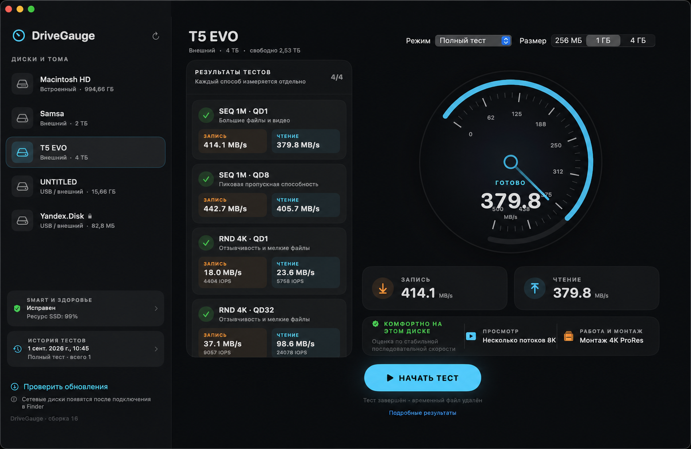
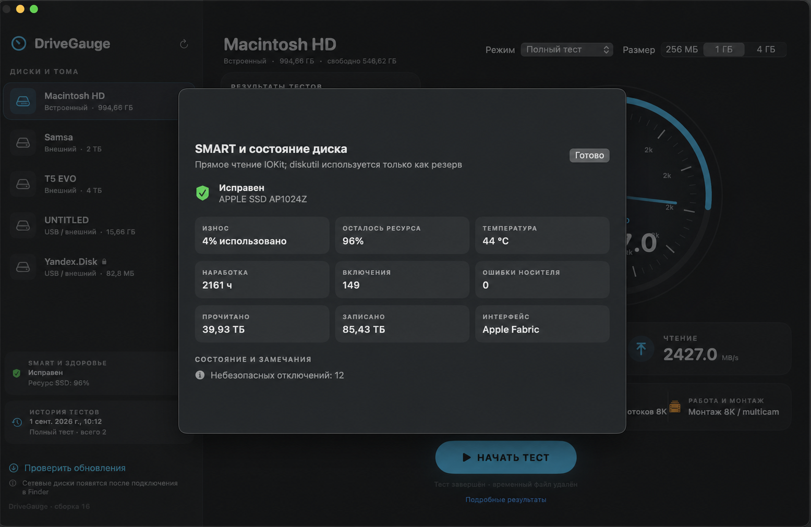

# DriveGauge

> **Только для Mac с Apple Silicon.** DriveGauge собирается исключительно для архитектуры `arm64` и работает на компьютерах Mac с процессорами Apple M1, M2, M3, M4 и новее. Компьютеры Mac с процессорами Intel не поддерживаются.

DriveGauge — нативное приложение для macOS, которое измеряет скорость встроенных, внешних USB/Thunderbolt и подключённых сетевых дисков. Во время теста текущая скорость отображается на спидометре, а каждый способ нагрузки получает отдельный результат записи, чтения и IOPS.



## Возможности

- автоматическое обнаружение доступных встроенных, внешних и сетевых томов;
- последовательное измерение скорости записи, затем скорости чтения;
- четыре режима: **Стандартный**, **Максимальная скорость**, **Работа приложений** и **Полный тест**;
- тестовые файлы объёмом 256 МБ, 1 ГБ или 4 ГБ;
- отдельные результаты для последовательной и случайной нагрузки;
- расчёт IOPS для операций блоками 4 КиБ;
- рекомендации по просмотру и монтажу видео;
- чтение SMART, ресурса SSD, температуры, наработки и ошибок, когда накопитель передаёт эти сведения;
- хранение завершённых тестов в SQLite и просмотр истории по каждому диску;
- ручная и автоматическая проверка подписанных обновлений через Sparkle 2;
- тёмный интерфейс, адаптированный под macOS.

## Системные требования

| Требование | Значение |
|---|---|
| Компьютер | Mac с Apple Silicon |
| Процессор | Apple M1 или новее |
| Архитектура | Только `arm64` |
| macOS | macOS 13 Ventura или новее |
| Intel Mac | Не поддерживается |

## Загрузка и установка

1. Скачайте [последнюю стабильную версию DriveGauge](https://github.com/Coloded/DriveGauge/releases/latest/download/DriveGauge-stable.dmg).
2. Откройте файл `DriveGauge-stable.dmg`.
3. Перетащите `DriveGauge.app` в папку **Applications / Программы**.
4. Запустите DriveGauge.

Если macOS впервые предупреждает о приложении, откройте **Системные настройки → Конфиденциальность и безопасность** и подтвердите запуск. DriveGauge не требует установки дополнительных тестовых утилит.

## Быстрый старт

1. Подключите диск. Сетевой том сначала подключите в Finder.
2. Запустите DriveGauge — все доступные тома появятся слева.
3. Выберите нужный диск.
4. Выберите режим тестирования.
5. Выберите объём тестового файла: 256 МБ, 1 ГБ или 4 ГБ.
6. Нажмите **«Начать тест»**.
7. Дождитесь завершения записи и чтения.

Во время теста слева по очереди заполняются результаты каждого профиля, а спидометр справа показывает текущую фактическую скорость. После завершения DriveGauge сохранит результат в истории выбранного диска.

## Выбор размера теста

| Размер | Когда использовать |
|---|---|
| **256 МБ** | Быстрая предварительная проверка. Результат сильнее зависит от кэшей накопителя и системы. |
| **1 ГБ** | Рекомендуемый повседневный вариант: разумный баланс времени и точности. |
| **4 ГБ** | Более продолжительная проверка стабильной скорости, особенно для быстрых SSD. |

Перед запуском DriveGauge проверяет доступное место и возможность записи. Дополнительно оставляется резерв 64 МиБ. Если места недостаточно или выбранный том доступен только для чтения, кнопка запуска блокируется и приложение показывает точную причину.

## Режимы тестирования

### Стандартный

Последовательный тест блоками 1 МиБ с глубиной очереди QD1, три прохода. Показывает типичную скорость одного потока при копировании больших файлов и работе с видео.

### Максимальная скорость

Последовательный тест блоками 1 МиБ с глубиной очереди QD8, три прохода. Показывает пиковую пропускную способность при нескольких одновременных запросах.

### Работа приложений

Случайный доступ блоками 4 КиБ при QD1 и QD32. Этот режим характеризует отзывчивость приложений, загрузку проектов, работу с большим количеством мелких файлов и параллельными операциями.

### Полный тест

Выполняет все четыре профиля:

- `SEQ 1M · QD1` — большие файлы и один последовательный поток;
- `SEQ 1M · QD8` — пиковая последовательная пропускная способность;
- `RND 4K · QD1` — отзывчивость при работе с мелкими файлами;
- `RND 4K · QD32` — мелкие операции под параллельной нагрузкой.

## Как читать результаты

- **Запись, MB/s** — скорость помещения данных на диск.
- **Чтение, MB/s** — скорость получения данных с диска.
- **IOPS** — количество операций ввода-вывода в секунду; особенно важно для 4-КиБ тестов.
- **QD** — глубина очереди, то есть количество запросов, которые могут обрабатываться параллельно.

Для последовательных тестов DriveGauge выполняет три прохода и показывает медиану, чтобы один случайный скачок не исказил итог. Скорость указывается в десятичных MB/s: 1 MB = 1 000 000 байт.

Нижний блок **«Комфортно на этом диске»** переводит стабильную последовательную скорость в понятные сценарии просмотра и монтажа видео. Это ориентир, а не гарантия: итог также зависит от кодека, битрейта, процессора и конкретного приложения.

## SMART и состояние накопителя

DriveGauge пытается напрямую читать SMART через штатный интерфейс macOS IOKit. Для общего статуса `diskutil` используется только как запасной источник.

Когда накопитель предоставляет данные, приложение может показать:

- общий статус;
- использованный и оставшийся ресурс SSD;
- температуру;
- часы работы и количество включений;
- объём прочитанных и записанных данных;
- ошибки носителя;
- небезопасные отключения и другие замечания.



Не каждый USB-корпус или переходник передаёт SMART. Сетевые диски также не предоставляют локальный SMART клиента. В таких случаях DriveGauge честно пишет, что данные недоступны или не поддерживаются, и не объявляет диск исправным без фактических показателей.

SMART помогает заметить проблемы, но не заменяет резервное копирование и специализированную диагностику неисправного накопителя.

## История тестов

Каждый полностью завершённый тест автоматически сохраняется в SQLite. История привязана к идентификатору диска, а не только к его отображаемому имени.

- при возвращении к диску показывается его последний результат;
- через карточку **«История тестов»** открывается список предыдущих запусков;
- календарь намеренно не используется: список не содержит пустых дат;
- незавершённые и отменённые тесты в историю не записываются.

База находится в пользовательской папке:

```text
~/Library/Application Support/DriveGauge/History.sqlite
```

## Безопасность данных

DriveGauge не изменяет и не удаляет пользовательские файлы.

1. На выбранном томе создаётся новый уникальный скрытый файл `.drive-gauge-<UUID>.tmp` с флагом `O_EXCL`.
2. `O_EXCL` не позволяет перезаписать уже существующий файл.
3. Приложение работает только с точным путём созданного им временного файла — без поиска по маскам и без обхода содержимого диска.
4. После завершения, остановки или ошибки удаляется только этот собственный временный файл.

Для системного тома тестовый файл создаётся в домашней папке пользователя, поскольку корень современных версий macOS защищён от записи.

## Как выполняется измерение

DriveGauge заранее выделяет выбранный объём, включает `F_NOCACHE`, записывает случайные данные, выполняет `fsync`, заново открывает файл только для чтения и отключает упреждающее чтение. Это уменьшает влияние файлового кэша macOS и заставляет результат лучше отражать реальную работу накопителя.

Для сетевого тома результат включает не только физический диск сервера, но также сеть, протокол общего доступа, серверный кэш и текущую нагрузку.

## Обновление приложения

Нажмите **«Проверить обновления»** в нижней части боковой панели или выберите **DriveGauge → Проверить обновления…** в меню macOS.

DriveGauge также периодически проверяет новую стабильную версию автоматически, но установка выполняется только после подтверждения пользователя. Канал обновлений и DMG защищены EdDSA-подписью Sparkle. Постоянная ссылка на последнюю версию:

```text
https://github.com/Coloded/DriveGauge/releases/latest/download/DriveGauge-stable.dmg
```

## Сборка из исходников

```bash
git clone git@github.com:Coloded/DriveGauge.git
cd DriveGauge
./scripts/build-app.sh
open dist/DriveGauge.app
```

При первой сборке официальный архив Sparkle 2.9.6 загружается с GitHub и принимается только при совпадении закреплённой SHA-256 суммы. Сценарий сборки создаёт только `arm64`-бинарник, готовое приложение и два DMG:

```text
dist/DriveGauge.app
dist/DriveGauge-<версия>-arm64.dmg
dist/DriveGauge-stable.dmg
```

## Выпуск новой версии

1. Обновите `CFBundleShortVersionString` и `CFBundleVersion` в `Resources/Info.plist`.
2. Обновите `updates/release-notes.md`.
3. Выполните:

```bash
./scripts/prepare-release.sh
git add .
git commit -m "Release <версия>"
git tag v<версия>
git push origin main --tags
```

Сценарий подписывает DMG приватным ключом Sparkle из macOS Keychain и создаёт `updates/appcast.xml`. В репозиторий попадает только публичный ключ. После отправки тега GitHub Actions публикует оба DMG в GitHub Releases.
